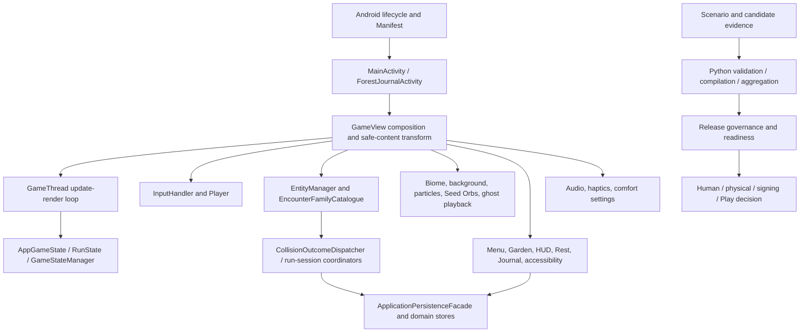

# Forest Run — Complete Knowledge Map and Execution Ledger

**Status:** Reconstructed index with bounded current-worktree delta review and exact-main verification/asset delta completed. File-level coverage retains explicit binary/reused-document limits; production declaration-level symbol inventory is merged across 256 Kotlin/Python/shell paths, with selective semantic call-graph depth.
**Baseline:** repository `Forest_Run`, branch `main`, committed `HEAD` `eeccc677107f69039dbf71053c18a9038d4b5ff6` (2026-10-03); investigation snapshot 2026-10-27.
**Working tree:** pre-existing user changes were present at investigation start (166 changed/untracked paths by `git status --porcelain`); they are preserved and treated as evidence to inspect, not as our edits.
**Evidence rule:** static inspection only in this investigation. Historical execution claims remain historical and do not establish current-worktree behavior.

This file is the single navigation point for the repository's recovered product, architecture, implementation state, historical evidence, coverage and future-work records. The detailed October 3 maps and dated audits are intentionally reused instead of copied wholesale. Their snapshot does not cover all current working-tree deltas; the new ledgers record this limitation explicitly.

## 1. Repository identity and evidence snapshot

Forest Run is a native Kotlin Android endless runner. Its game loop uses a custom `SurfaceView`/`Canvas`; its product loop combines a run across five biomes, encounter families, Seed/Bloom mechanics, Rest, and a persistent Garden. The project also contains persistence/recovery, relationships and Journal presentation, accessibility, deterministic scenario/evidence tooling, and candidate-bound release governance. It is not an ML/training project: training-control files exist to prove that no trainable surface is applicable, not to define model-training goals.

| Evidence item | Snapshot fact | Status / interpretation |
|---|---|---|
| Repository | `.` | Confirmed from current workspace |
| Branch / HEAD | `main`, `eeccc677107f69039dbf71053c18a9038d4b5ff6` | Current committed baseline; source tree is dirty |
| Tracked files | 939 | `git ls-files` count at start |
| Changed/untracked paths | 166 | `git status --porcelain=v1`; user-owned pre-existing state |
| Visible workspace paths | 961 initial listing | The union inventory adds nine tracked release paths hidden by ignore rules; the baseline inventory contained 1006 paths before the EVID-080 test candidate was added; the current inventory contains 1007 paths |
| Submodules | None reported by `git submodule status` | No populated submodule entries |
| Instructions | No `AGENTS.md` or `INSTRUCTIONS.md` found under the repository/parent search | No additional local instruction source found |
| Prior implementation map | `docs/REPO_CODEBASE_MAP.md`, begun 2026-10-03 | Reusable with delta review; its own scope note disclaims line-complete coverage |
| Prior documentation map | `docs/REPO_MEMORY_MAP.md`, snapshot 2026-10-03 | Reusable with delta review for docs/history/navigation |
| Historical remediation ledger | `docs/AUDIT_LEDGER.md`, current reconciliation through 2026-10-02 | Historical provenance, not exact-current state |
| Runtime verification | Authorized verification deltas recorded in [verification_delta_2026-10-27.md](repository_knowledge/verification_delta_2026-10-27.md), [exact-main verification and asset delta](repository_knowledge/verification_delta_2026-10-27_exact-main.md), and EVID-072–EVID-080 | Full Python/JVM suites, focused exact-main tests, lint/package and exact-main API 35 hosted connected validation passed; physical-device and external acceptance remain open |

### Latest candidate reconciliation — 2026-10-27

The clean detached candidate `d1f31d473f5ca9303706164b6cc817703e0e7c7c` matched `origin/main` during a targeted source-completion re-audit. The original workspace checkout and its user-owned dirty changes were preserved. The re-audit covered core gameplay/input/collision/spawn, all 28 scenarios, persistence/recovery, accessibility/audio/haptics, runtime assets, release documentation and CI wiring. It found no new requirement-backed source defect; the suspected frame-post telemetry issue is already guarded by the production surface-post boundary. See [source-completion reconciliation](repository_knowledge/source_completion_reconciliation_2026-10-27.md) and evidence `EVID-074`. Exact-head Android run `40468712221` completed successfully: host/release/lint/package and API 35 connected validation passed. This remains emulator evidence; it does not establish physical-device or human acceptance.

The exact `origin/main` candidate advanced to `1d1a73451ad59e088d4117216d07162628913ff8`; its changes from d1 were documentation-only. Exact-main hosted run `40471923390` passed host/release/lint/package and API 35 connected validation. Focused exact-main verification passed 129 selected JVM/UI tests and 113 evidence-tooling Python tests (EVID-076/EVID-078). This closes TASK-C-009 and the automated/API35 scope of TASK-C-010. EVID-079 adds 23 frame-admission/Player boundary tests, closing TASK-C-007 at its authored unit/property scope; TASK-C-008 remains partial: the new process-death instrumentation candidate compiles (EVID-080). The first published candidate failed a host shell-contract check; the corrected runner now passes all 1,387 Python host-tooling tests locally (EVID-082/EVID-083), and awaits a corrected hosted run. All 29 runtime sprite sheets were visually inspected; identical bird ordinary/flying asset pairs and quality risks are documented for human creative review, not treated as code defects (EVID-077).

The file inventory excludes `.git` internals and ignored generated/build trees. It includes visible workspace artifacts such as `.coverage`, `.training_control`, user-provided issue notes, and tracked release paths hidden by ignore rules; each is classified rather than treated as authored product source. Inventory records distinguish discovery from actual content inspection.

## 2. Executive technical reconstruction

The system is organized around Android lifecycle ownership (`MainActivity`/`GameView`), a game-thread update/render cycle, explicit application and run state, input arbitration, player physics, biome/background rendering, entity/encounter lifecycle, collision outcome arbitration, run-session transitions, and persistence managers. Garden purchases and long-term memories have distinct persistence boundaries. Audio, haptics, particles, accessibility, safe-content layout, and the Forest Journal supply presentation and interaction around the core loop.

The second major subsystem is evidence engineering. Python and shell tools construct, validate, aggregate, bind, and publish evidence for deterministic scenarios, device/human acceptance, package identity, visual assets, performance, dependencies/SBOM, store delivery, governance, and release readiness. These tools validate supplied evidence and source contracts; they cannot create human, physical-device, legal, hosted-policy, signing, Play Console, or accountable-approval evidence.

The October 3 maps provide a broad, detailed baseline over modules, docs, tests, scripts and integration clusters. The current working tree adds or changes substantial Android, test, release-script and evidence-tooling content. This knowledge map treats that delta independently and does not infer successful execution from added tests or historical reports.

## 3. Complete project vision and goal tree

The recoverable goal structure is recorded in `repository_knowledge/goal_ledger.json` and linked requirements/capabilities in `MASTER_EXECUTION_LEDGER.json`. `GOAL-008`–`GOAL-013` preserve historical architecture items and their later documented closure; `GOAL-014` retains an unselected optional proposal.

| Goal | Recoverable objective | Scope/status |
|---|---|---|
| `GOAL-001` | Deliver the authored Forest Run native Android game loop and five-biome, nineteen-family forest journey | Current product objective; implementation is extensively represented in Kotlin source and canonical docs |
| `GOAL-002` | Make movement, encounter outcomes, Seed/Bloom, and progression behavior deterministic, fair and state-owned | Engineering/product objective supported by source contracts and many dated audits; current delta review applies |
| `GOAL-003` | Preserve Garden, relationship, wardrobe, run history, ghost and Journal memory with domain-appropriate persistence/recovery | Implemented architecture described in README and ARCHITECTURE; runtime status not refreshed here |
| `GOAL-004` | Provide accessible and comfort-aware touch, Canvas semantics, Journal and transient audio/haptic/visual feedback | Implemented source capability with physical/accessibility acceptance remaining external |
| `GOAL-005` | Produce candidate-bound, deterministic and auditable engineering/release evidence | Extensive source tooling/docs; evidence generation and validators do not equal acceptance |
| `GOAL-006` | Reach an accountable production release decision with physical, human, rights, privacy, security and Play evidence | Explicitly planned downstream outcome; several gates are externally owned and unresolved |
| `GOAL-007` | Demonstrate that model training is inapplicable and no trainable surface exists | Explicit scope control, not a training feature; source evidence exists in `training_control/` and scripts |

Historical audits contain much finer requirements than this top-level tree; they remain linked in `docs/REPO_MEMORY_MAP.md` and `docs/AUDIT_LEDGER.md`. Requirement IDs in the new machine ledger are stable and preserve historical/current/derived distinctions. New optional ideas are not silently promoted into mandatory requirements.

## 4. Historical development and achievement timeline

- **2026-08 through 2026-09:** dated audit trail records successive source-level remediation of encounter fairness, persistence/recovery, accessibility, deterministic evidence, candidate binding, release tooling, and whole-software closure. Consult `docs/AUDIT_LEDGER.md` and its linked audits for specific claims and revision-bounded evidence.
- **2026-09-20:** `docs/audits/2026-09-20_whole_software_closure.md` records a historical closure checkpoint plus deliberately external release gates. It is not evidence for the current worktree.
- **2026-10-02:** latest reconciliation in `docs/AUDIT_LEDGER.md` records source-addressable progress and external remaining gates; historical assertions must be reconciled to current source.
- **2026-10-03:** `docs/REPO_CODEBASE_MAP.md` and `docs/REPO_MEMORY_MAP.md` began detailed code and documentation mapping. The code map explicitly says its inventory is not equivalent to having read every line.
- **2026-10-27:** the original-worktree boundary and earlier audits are retained; exact-main source/test/CI deltas were reconciled, targeted tests and hosted CI were verified, and all runtime sprite sheets received a bounded visual review. Human/device and external gates remain open.

No claim is made that repository history records every original design decision; issues/discussions/PRs outside available local evidence were not presumed accessible.

## 5. Repository structure

```text
app/src/main/java/.../forestrun/   Kotlin Android application, engine, entities, systems, UI, utilities
app/src/main/assets/               Runtime sprites and other packaged assets
app/src/main/res/                  Android resources, strings, layouts, raw media, XML
app/src/test/                      JVM/Robolectric test source (not executed here)
app/src/androidTest/               Instrumentation/physical-oriented test source (not executed here)
scripts/                           Python and shell evidence, validation, release and audit tooling
training_control/                  Explicit no-trainable-surface applicability evidence
docs/                              Product/design/architecture/evidence specs and dated audits
docs/audits/                       Chronological, revision-specific investigation records
release/google-play/               Authored store metadata/copy and release inputs
Final_Assets (2)/                  Source/reference creative material, distinct from packaged runtime assets
artifacts/, .training_control/     Present generated/user workspace evidence; not assumed canonical source
```

The exhaustive path-level list and classification are in `repository_knowledge/file_inventory.json`; the October 3 maps remain the detailed historical file/symbol guide. Build outputs, caches and ignored files were not promoted to authored logic.

## 6. Overall architecture and dependency direction



This is a high-level dependency view; `docs/ARCHITECTURE.md` and `docs/REPO_CODEBASE_MAP.md` describe the actual ownership and ordering contracts. Downstream architecture facts are source/documentation claims, not new runtime validation.

## 7. Functionality, algorithms and architecture inventories

The machine ledgers link each capability to its requirements, evidence and source files. Principal implemented mechanism families include:

- App/run state machines and ordered session transition planning.
- Gesture arbitration, bounded jump/duck motion and safe-content coordinate transforms.
- Entity spawning, encounter-family catalogue, collision ordering and single terminal encounter outcomes.
- Seed/Bloom threshold, timer and presentation/conversion behavior.
- Garden economy and atomic sequential purchase ownership.
- Relationship arcs, run outcomes, memory/story projections and read-only Forest Journal.
- Ghost recording, identity, namespace-bound persistence, playback, promotion/recovery and evidence binding.
- Accessibility virtual nodes/actions, announcement coalescing and comfort controls.
- Frame telemetry and deterministic scenario trace contracts.
- Evidence compilation, strict input validation, source immutability, candidate identity, supply-chain/SBOM, store asset and release readiness mechanisms.

This repository has no ML model architecture, model training algorithm, dataset pipeline, or benchmark suite for predictive performance. Android gameplay tests and device acceptance are distinct from research-model experiments. Existing `run_all_training.py` and `training_control/` must be interpreted with the explicit no-trainable-surface contract; they are not evidence that training is a project capability.

## 8. Data, state and persistence architecture

Gameplay/runtime inputs are Android touch/lifecycle events, packaged assets/resources, and domain state. `GameView` composes live owners; encounter and run transitions mutate domain state through explicit managers and persistence adapters. Persistent domains include preferences, ghost files/sidecars and run-outcome recovery records. The architecture intentionally does not claim one global transaction across unrelated storage domains. See `docs/ARCHITECTURE.md`, `docs/GHOST_PERSISTENCE_NAMESPACES.md`, `docs/GHOST_PERSISTENCE_RECOVERY.md`, `docs/RUN_OUTCOME_PERSISTENCE.md`, and `docs/RUN_OUTCOME_RECOVERY.md`.

Evidence workflows consume candidate/source identities, manifests, reports, screenshots, device traces, dependency inventories and governance declarations. Validators should be treated as evidence admission tools. No private value from configuration or prompts is reproduced here.

## 9. Experiments, benchmarks and evaluation

No ML/research benchmark or experiment result is established by the available project definition. Applicable verification/evaluation tracks are: deterministic scenario traces; source-level and automated regression checks; device performance/input latency; visual regression; device/human/accessibility acceptance; installed candidate identity; Play-delivery and release-governance evidence. The specs define workflows and evidence contracts, but this investigation did not run them. Physical measurements and human acceptance remain future evidence tasks.

## 10. Configuration, dependencies, execution and state recovery

The Android module is configured in `app/build.gradle.kts`, with root Gradle settings/properties and wrapper files. `docs/ARCHITECTURE.md` records min API 24, compile/target 36, Java/Kotlin 17 bytecode, CI Java 21, landscape orientation, R8 and external signing inputs. Treat these as prior documented contracts pending delta inspection; do not copy secret values. Python/shell tooling is invoked by explicit scripts and CI workflows. Per-tool interfaces and evidence schemas are documented in the relevant specs and `REPO_CODEBASE_MAP`.

Current execution pathways include Android launcher → activity → GameView/surface lifecycle → game thread and input/state updates; Forest Journal activity → read-only history projection; and release evidence workflows → build/source/asset/dependency/device/human/governance evidence validators → candidate-bound readiness/operator gate. Individual tools may be disconnected or source-only; consult the ledgers before claiming reachability.

## 11. Current delta findings and documentation-to-code consistency

The changed working tree is an active user-owned state. The static delta review identified (among other items) a new save-integrity startup gate, gameplay score multiplier logic, feedback lifecycle changes, compact-screen UI changes and evidence/screenshot tooling changes. One specific example is a timed score-boost path in `GameStateManager` whose optional arguments currently have no production call site; the presence of the method is therefore not the same as an active product capability. This remains an implementation observation and is not labeled a confirmed defect or approved feature request.

See `repository_knowledge/DELTA_REVIEW.md` for scoped findings and limits. The later authorized full suites/lint/APK build provide source-level regression evidence, while connected/device and external acceptance remain open. Historical docs may describe previous exact-head validations; their claims remain pinned to those revisions. One statically established gap between OWL_DIVE and the noninteractive store screenshot route was corrected under TASK-A-035; actual screenshot state is tracked by TASK-C-013.

## 12. Achievements, partial/missing capabilities and external gates

The prior audit trail documents extensive source-level architecture and remediation. The current merged candidate passes the full Python/JVM suites, lint and debug/release APK assembly (EVID-072). These results do not close device or external acceptance.

Explicit unresolved production acceptance includes:

- representative physical-device compatibility, performance, stability, battery/thermal and input-latency acceptance;
- human gameplay fairness/readability and physical accessibility/TalkBack/Switch Access review;
- final art, animation, audio, haptic, rights, attribution and licensing decisions;
- production signing and Play App Signing identities, Play Console declarations and candidate delivery;
- hosted privacy policy and externally verified security/reporting configuration;
- dependency/artifact notices and vulnerability decisions;
- accountable release approval based on the exact frozen candidate and linked evidence.

These are not source defects unless the relevant authorized owner establishes that the source contract itself is missing. The compact-screen Bamboo presentation is an identified product/human-review caveat in the current reconciliation; no unapproved implementation is inferred.

## 13. Traceability and ledgers

The coordinated source of structured state is [`repository_knowledge/`](repository_knowledge/):

- [File inventory](repository_knowledge/file_inventory.json) — visible path inventory, classification and coverage state.
- [Goal ledger](repository_knowledge/goal_ledger.json) — stable goal hierarchy and provenance classification.
- [Symbol inventory](repository_knowledge/symbol_inventory.json) — 6,137 unique declaration records keyed by path, fully qualified name, and source start line: 91 prior detailed records retained plus four static production-source declaration shards; limitations and shard provenance are recorded.
- [Master execution ledger](repository_knowledge/MASTER_EXECUTION_LEDGER.json) — requirements, capabilities, findings, gaps and future task contracts.
- [Task dependencies](repository_knowledge/execution/TASK_DEPENDENCIES.json) — dependency, conflict and parallel-wave views.
- [Evidence index](repository_knowledge/execution/EVIDENCE_INDEX.json) — evidence IDs, paths, snapshot, authority and limitations.
- [Phase handoffs](repository_knowledge/execution/PHASE_HANDOFFS.json) — phase-specific queues and constraints.
- [State history](repository_knowledge/execution/STATE_HISTORY.jsonl) — append-only initial state and subsequent reconciliation events.
- [Execution dashboard](repository_knowledge/execution/EXECUTION_DASHBOARD.md) and [next actions](repository_knowledge/execution/NEXT_ACTIONS.md) — human-readable views synchronized with machine records.
- [Delta review](repository_knowledge/DELTA_REVIEW.md) — current changed-tree findings and coverage boundary.
- [Source-completion reconciliation](repository_knowledge/source_completion_reconciliation_2026-10-27.md) — fresh bounded review of gameplay, scenarios, persistence, accessibility/audio, assets, release wiring and exact-head CI state.
- [Exact-main verification and asset delta](repository_knowledge/verification_delta_2026-10-27_exact-main.md) — focused exact-main Python/JVM results, exact hosted workflow, all 29 runtime sprite-sheet observations, and the remaining C-007/C-008 evidence boundaries.
- [Historical architecture reconciliation](repository_knowledge/HISTORICAL_ARCHITECTURE_RECONCILIATION.md) — Aug 6 open items reconciled against Aug 9 closure and later evidence.

The core trace chain is `GOAL → REQ → CAP → ALG/COMP → SYM/file → PATH → EVID → FIND/GAP → TASK`. IDs in JSON are stable; do not regenerate them during future updates.

## 14. Remaining work and future phase policy

The user authorized source completion and applicable verification. TASK-C-005 statically reconciled the screenshot canonicality contract and TASK-A-026 corrected the verifier source. TASK-A-003 also completed an accessible-source intent search; no gameplay requirement to activate the optional score multiplier was found. TASK-A-027 completed a bounded Kotlin/Python/shell placeholder review; no additional requirement-backed source gap was found (EVID-056). Authorized verification evidence is recorded in the [verification deltas](repository_knowledge/verification_delta_2026-10-27.md) and [exact-main verification and asset delta](repository_knowledge/verification_delta_2026-10-27_exact-main.md), plus EVID-072–EVID-080. TASK-C-009 is completed for the five named authored Python test files (113 tests); TASK-C-010 is completed for automated UI/build/API35 scope; TASK-C-007 is complete at its authored deterministic unit/property scope (50 focused tests across EVID-076/EVID-079). TASK-C-008 remains partial: EVID-080 compiles a process-death candidate, but no connected execution was available. TASK-C-011 remains partial pending that residual and targeted integration reconciliation; C-012 is complete at authored concurrency-test scope. C-013 and physical-device/external acceptance remain outstanding. Earlier C-001–C-004/C-006 remain canceled and C-005 remains a completed static contract review. Other work remains phase-gated:

- **Implementation completion:** only after a requirement-level source gap is established and an implementation scope is authorized. No broad source backlog is inferred from historical audit notes.
- **Acceleration:** measure a representative, authorized physical baseline before treating static opportunities as bottlenecks; then preserve semantic invariants and remeasure.
- **Fidelity verification:** derive expected behavior from current specs/design/mathematics, independently of the implementation, and execute checks only in an authorized phase.
- **Engineering closure/release:** close external gates with accountable owners and candidate-bound evidence; source automation cannot substitute for those decisions.
- **Final reconciliation:** inspect only changed code, affected evidence, and residual requirements, not repeat completed historical audits indiscriminately.

Atomic tasks, dependencies, status axes and acceptance criteria live in `MASTER_EXECUTION_LEDGER.json`. Tasks for later phases are planned/deferred and are not current executable assignments.

## 15. Coverage and investigation limits

Published source-completion candidate: `df705c65c7f0a7ef03669a0c6767de5f381b418a` on `origin/main` (remote ref verified after push); hosted CI state is captured in EVID-073.

The original repository snapshot had 939 tracked files and 166 dirty paths at the starting snapshot. An initial visible-path query returned 961 but omitted nine tracked release paths because ignore rules hid them. The initial union inventory contained 1004 path records; subsequent evidence and knowledge artifacts brought the inventory to 1006 records before the EVID-080 test candidate; it now contains 1007 paths. It includes tracked paths, visible workspace paths, excluded generated artifacts and knowledge-base documentation. The prior code map reports a 118,561-line inventory and detailed subsystem reviews, but expressly warns that inventory is not proof every line was read. The original dirty regular-file bytes remain SHA-256 pinned under `working_tree_snapshot_id` in `file_inventory.json`; investigation-created documents are excluded from that self-referential snapshot. The present pass reuses that work and performs targeted delta inspection; it does not claim every byte, asset, generated file or historical commit has been reread. Production declaration names, locations and concise contracts are indexed across 256 paths, but semantic caller graphs are selective and binary files remain metadata/hash-only. Any item without substantive inspection evidence remains inventoried/partial rather than fully inspected.

The initial static investigation did not execute tests or workflows. Later, authorized verification ran the documented Python and JVM suites, lint and debug/release APK assembly, focused exact-main tests, and hosted API 35 connected instrumentation; see EVID-072–EVID-083. EVID-080 also records a newly compiled but unexecuted process-death test candidate. Local `adb` is unavailable, so the candidate connected check remains pending; prior exact-main connected evidence comes from hosted CI and does not substitute for physical-device review. Inference, training, benchmarks, release preparation and external service actions remain unperformed; external release evidence remains unresolved.

## 16. Knowledge-base navigation

The repository-specific applicability crosswalk is [APPLICABILITY_AND_VERIFICATION_MATRIX.md](repository_knowledge/APPLICABILITY_AND_VERIFICATION_MATRIX.md), with machine-readable rows in [applicability_matrix.json](repository_knowledge/applicability_matrix.json).

Production declaration inventory shards: [Kotlin engine A–M](repository_knowledge/symbol_shards/engine_a_m.json), [Kotlin engine N–Z](repository_knowledge/symbol_shards/engine_n_z.json), [non-engine Kotlin](repository_knowledge/symbol_shards/kotlin_non_engine.json), and [Python/shell](repository_knowledge/symbol_shards/python_shell.json). Their merged, stable-ID index is [symbol_inventory.json](repository_knowledge/symbol_inventory.json); file-level shard counts and dispositions are also recorded in [file_inventory.json](repository_knowledge/file_inventory.json).

The resumable future-phase handoff is [FUTURE_EXECUTION_HANDOFF.md](repository_knowledge/FUTURE_EXECUTION_HANDOFF.md). Production Kotlin batch A-010 has a per-file symbol shard at [production_kotlin_A010.md](repository_knowledge/production_kotlin_A010.md). Per-file A–G and R–W engine contracts are in [test_contracts_kotlin_engine_A-G.md](repository_knowledge/test_contracts_kotlin_engine_A-G.md) and [test_contracts_kotlin_engine_R-W.md](repository_knowledge/test_contracts_kotlin_engine_R-W.md). Machine-readable source-test assertion records are in [test_contract_inventory.json](repository_knowledge/test_contract_inventory.json); they describe authored contracts and do not report test execution. Historical audit reconciliations are in [historical_audit_batch_A013.md](repository_knowledge/historical_audit_batch_A013.md), [historical_audit_batch_A014.md](repository_knowledge/historical_audit_batch_A014.md), and [historical_audit_batch_A015.md](repository_knowledge/historical_audit_batch_A015.md). The current execution status view is [EXECUTION_DASHBOARD.md](repository_knowledge/execution/EXECUTION_DASHBOARD.md). Completed bounded artifact handoffs are [A-016](repository_knowledge/inspection_TASK-A-016.md), [A-017](repository_knowledge/inspection_TASK-A-017.md), and [A-018](repository_knowledge/inspection_TASK-A-018.md). The machine-readable current ledgers are the source of task and file status.

1. Start with `README.md` for the player-facing product and `docs/ARCHITECTURE.md` for canonical runtime ownership.
2. Use `docs/REPO_MEMORY_MAP.md` for the existing document index, product ownership map, evidence chain and release gates.
3. Use `docs/REPO_CODEBASE_MAP.md` for detailed implementation clusters and its explicit read-coverage record.
4. Use `docs/AUDIT_LEDGER.md` and linked dated audits for historical rationale and revision-bounded outcomes.
5. Use this directory's JSON ledgers for current coverage, requirement traceability and future task readiness.
6. Before acting, reconcile current `HEAD` and worktree against each record's evidence revision; do not assume the documentation's snapshot is current.

## 17. Complete functionality and algorithm inventory

Principal functionality and mechanism families are summarized in Sections 7–10 and linked in [the master execution ledger](repository_knowledge/MASTER_EXECUTION_LEDGER.json). The former 91-record selected symbol map is retained within the expanded inventory: 6,137 unique declaration records keyed by path, fully qualified name, and source start line now cover meaningful declarations across 256 production Kotlin/Python/shell paths. FIND-014/GAP-005 is resolved at declaration-index coverage level by completed TASK-A-030–A-033 (EVID-067). Consumer/call relationships are selective, and some descriptions are based on signature or source context; refer to the [four source shards](repository_knowledge/symbol_shards/) and their limitations. The larger implementation ownership, caller paths and historical reading ledger remain in `docs/REPO_CODEBASE_MAP.md`. No feature is inferred complete from a class/configuration name alone. Current changed-region status is in [the delta review](repository_knowledge/DELTA_REVIEW.md) and [symbol inventory](repository_knowledge/symbol_inventory.json).

## 18. Model architecture inventory

No predictive or generative ML model is part of applicable product scope. Android entities and gameplay state are hand-authored runtime mechanisms, not learned models. `run_all_training.py` does not create a training goal; `GOAL-007` and `CAP-008` record the explicit no-trainable-surface boundary. No model dataset or training experiment is applicable absent a new explicit requirement.

## 19. Detailed data, state and transformation architecture

Section 8 and `docs/ARCHITECTURE.md` map Android input/lifecycle events into game state and entities; packaged resources feed rendering/audio owners; persistent domains use application/domain storage boundaries; evidence tools transform bounded source/device/package/screenshot/dependency inputs into validated manifests, aggregates and indexes. The code map gives further detail. Assets and generated evidence are inventoried separately; not every binary was visually decoded.

## 20. Training and optimization infrastructure

Model training is not applicable and was not run. Optimization is not justified by source inspection alone: no current bottleneck or speedup is established. `TASK-B-001` requires physical measurement before `TASK-B-002` can identify candidates.

## 21. Experiment, benchmark and evaluation architecture

The repository has software verification and evidence workflows, not research-model benchmark suites. Scenario traces, tests, visual comparisons, device performance profiles, human/accessibility reviews and release evidence are distinct evidence classes. Their specifications are linked in the prior memory map; current changed workflows were not run. Phase C and D task contracts define future evidence without claiming results.

## 22. Runtime pathways and configuration contracts

The three principal `PATH-*` records appear in `MASTER_EXECUTION_LEDGER.json`. Detailed conditional routes live in `docs/REPO_CODEBASE_MAP.md` and `docs/ARCHITECTURE.md`. Build/runtime contracts and documented Android SDK/bytecode settings are summarized in Section 10; external signing material is not reproduced. A parsed flag or generated manifest does not prove that an operation completed.

## 23. File-by-file and symbol-level code map

`repository_knowledge/file_inventory.json` accounts for every tracked or visible path in scope, including generated artifacts and binary assets with proper classifications. It records discovery/inspection dispositions, not uniform deep inspection. `symbol_inventory.json` captures 6,137 declaration records across 256 production Kotlin/Python/shell paths; prior variable-depth analysis remains in `docs/REPO_CODEBASE_MAP.md`. Consumer links and some purpose descriptions remain selective and are explicitly qualified.

## 24. Component interaction and dependency graph

The Mermaid graph in Section 6 shows high-level runtime and evidence-engineering dependencies. `PATH-*` records describe principal data/control routes. `execution/TASK_DEPENDENCIES.json` models future task prerequisites and parallel waves; it is separate from the component graph. `stable_file_reader.py` is a shared evidence-tooling dependency whose consumers need coordinated verification.

## 25. Scientific and mathematical foundations

No ML/research model or scientific training method is applicable. Mathematical mechanisms relevant to the game include bounded movement/input admission, deterministic collision/outcome ordering, score/Seed/Bloom transitions, normalized coordinate/layout transforms and relationship/progression projections. Exact ownership/formulations are linked in the code map and specifications; no paper-canonical algorithm or empirical result is inferred without evidence.

## 26. Historical decisions, assumptions and limitations

The project distinguishes app/run state, keeps separate persistence owners rather than claiming a global transaction, disables entity pooling absent a complete reset contract, keeps Journal read-only and makes release evidence candidate-bound. `docs/ARCHITECTURE.md` and dated audits record rationale. Current limits include fixed landscape, candidate/hardware dependence, external release ownership and partial delta coverage; Section 11 and task records preserve uncertainty.

## 27. Goal-to-implementation and algorithm traceability

`goal_ledger.json` contains stable `GOAL-*` identities. The master execution ledger links `REQ-*` and `CAP-*` to algorithms, components, execution paths, evidence, findings, gaps and tasks. `ALG-*` records major mechanism families; the declaration-level `SYM-*` index links to the detailed prior code map. Applicability records are mapped in the linked matrix. Add future IDs only for distinct supported methods, not hypothetical features.

## 28. Capability-to-execution matrix

The `PATH-*` records identify game startup/frame execution, Journal projection and release evidence/readiness. `CAP-*` records link capabilities to requirements and source evidence. Implementation state, verification, investigation coverage and task execution status remain distinct.

## 29. Evidence provenance, findings and remaining work

`execution/EVIDENCE_INDEX.json` assigns evidence IDs and revision/authority limits. `FIND-*` records distinguish observations from conclusions; `GAP-*` records represent evidence/coverage or external-gate differences; `TASK-*` records provide bounded future contracts. Earlier scoped workstreams did not establish a source defect. The subsequent TASK-C-005/TASK-A-026 review established and corrected one raw screenshot canonicality mismatch statically; runtime behavior remains unverified. The uninvoked multiplier remains an unresolved question, not a mandatory gap.

## 30. Self-audit and future-agent resumption

The initial inventory had 1004 path records: 950 fully statically inspected, 17 partially inspected, 34 documented knowledge artifacts, and 3 excluded generated artifacts. Subsequent evidence documents and the EVID-080 AndroidTest candidate bring the current inventory to 1007 records (951 fully statically inspected, 17 partial, 36 documented artifacts and 3 excluded); the original source-inspection counts remain otherwise unchanged. Partial entries include prior-map reuse, bounded changed-region reviews, and audio/font/wrapper binary metadata-only checks. The ledgers now contain 15 goals, 19 requirements, 16 capabilities, 4 mechanism families, 3 principal execution paths, 6,137 declaration records across 256 production paths, 17 findings, 7 gaps (two documentation gaps resolved and the OWL_DIVE source gap closed), and 58 tasks (40 completed, 2 partially completed, 11 deferred, 5 canceled/superseded). All 140 dated historical audit documents were read and reconciled across three batches. The 389 test-contract records describe authored assertions; per-file execution dispositions are now reconciled in `test_contract_inventory.json` against EVID-072/EVID-074/EVID-075: 134 Python test files, 242 JVM test files, and 8 Android connected test files passed, while 3 `@LargeTest` suites remain unexecuted and 2 Android support files are not test classes. Local and hosted verification evidence is recorded in [verification_delta_2026-10-27.md](repository_knowledge/verification_delta_2026-10-27.md), [exact-main verification and asset delta](repository_knowledge/verification_delta_2026-10-27_exact-main.md), and [source-completion reconciliation](repository_knowledge/source_completion_reconciliation_2026-10-27.md): 1,387 Python tests and 1,297 JVM tests passed on the merged source payload; 113 focused Python and 129 focused JVM/UI tests and 23 movement-bound/physics tests passed at exact main; lint/package and exact d1 plus exact-main API 35 connected jobs succeeded. Local `adb` and a physical device remain unavailable; human and external release gates remain outstanding. Results remain revision-bound and do not apply to the preserved dirty checkout as a whole. Resume through `execution/PHASE_HANDOFFS.json`, reconcile the source tree and remote revision, and promote only dependency-ready authorized work.


### Current artifact-batch reconciliation

A-016 found several historical tranche documents whose remaining-work paragraphs are stale against later canonical architecture and recovery evidence; the contradictions and exact references are in `repository_knowledge/inspection_TASK-A-016.md`. No closed source task was reopened. A-017 confirms build/workflow contracts statically and leaves execution unverified. A-018 reads XML fully but inspects images, fonts, and audio only through metadata/hashes; visual suitability, audible content, rights, and approval remain unknown.


Completed targeted inspection shard: [A-023 Python/Shell](repository_knowledge/deep_inspection_TASK-A-023_python_shell.md).


Completed targeted inspection shard: [A-024 Kotlin](repository_knowledge/deep_inspection_TASK-A-024_kotlin.md).


Completed targeted inspection shard: [A-025 prior documents](repository_knowledge/deep_inspection_TASK-A-025_prior_docs.md). The targeted source correction is recorded as TASK-A-026 and EVID-050 in the master execution ledger and evidence index.


### Concurrency verification contract

The verification matrix includes a dedicated concurrency/race suite (`VER-013`) covering lifecycle thread replacement, asynchronous audio ownership and atomic evidence publication/rollback under concurrent changes. Its scoped contract `TASK-C-012` was executed on the frozen d1 candidate: 54 Python filesystem publication tests, 29 targeted JVM audio/thread tests, and the exact-head API 35 connected lifecycle suite passed (EVID-075 plus EVID-074). This proves only the authored cases on those environments; it does not establish universal race freedom or physical-device behavior.
